<p align="center">
  <a href="https://provaai.vercel.app/">
    
  </a>
</p>

<p align="center">
  Avaliações individuais, do perfil do aluno à prova impressa.<br />
  <strong>O professor orienta, revisa e aprova cada etapa.</strong>
</p>

<p align="center">
  <a href="https://provaai.vercel.app/"><strong>Conheça a Provaai ↗</strong></a>
  &nbsp; · &nbsp;
  <a href="#comece-por-aqui">Executar localmente</a>
  &nbsp; · &nbsp;
  <a href="docs/GUIA-TECNICO.md">Guia técnico</a>
  &nbsp; · &nbsp;
  <a href="docs/Especificacao-Provaai.pdf">Documentação acadêmica</a>
</p>

<p align="center">
  
  
  
  
</p>

---

## Uma avaliação que considera cada aluno

A **Provaai** reúne turmas, perfis pedagógicos, modelos e avaliações em um espaço de trabalho para professores. As questões podem ser escritas pelo professor ou preparadas com apoio de IA, a partir da matéria, dos tópicos e das necessidades de cada aluno. Todo rascunho passa por revisão e aprovação antes da exportação.

Para conhecer o fluxo, abra o [site](https://provaai.vercel.app/) e selecione **Explorar demonstração**. Não é necessário criar uma conta; os dados são fictícios e ficam apenas na memória da página.

## O que você encontra

| | Recurso | Como ajuda no trabalho |
| :---: | --- | --- |
| **01** | **Turmas e perfis** | Organize alunos, conteúdos, dificuldades e critérios pedagógicos. Filtre ativos e inativos; reative alunos escolhendo a turma, sem perder o histórico. |
| **02** | **Seus modelos de prova** | Anexe PDF, DOC ou DOCX, defina um padrão para sua conta e guarde uma escolha diferente por turma. |
| **03** | **Preparação com IA** | Escolha o total de questões e a divisão entre objetivas e discursivas. Acompanhe a geração em segundo plano. |
| **04** | **Provas coletivas** | Encontre avaliações por aluno, código ou título. Filtre pendências e aprove o conteúdo antes de baixar. |
| **05** | **Provas individuais** | Prepare uma prova para um aluno específico, mantendo o vínculo dele com a turma de origem. |
| **06** | **Arquivos prontos para uso** | Exporte PDF ou DOCX, com gabarito separado, ou reúna provas aprovadas em um ZIP. |
| **07** | **Sessão com prazo de inatividade** | Receba um aviso antes de sair após 30 minutos sem interação e confirme quando quiser continuar conectado. |

### Da turma à impressão

```mermaid
flowchart LR
    A[Cadastre a turma] --> B[Adicione alunos e perfis]
    B --> C[Escolha modelo e questões]
    C --> D[Prepare os rascunhos]
    D --> E[Revise e aprove]
    E --> F[Exporte as provas]
    style A fill:#5210ce,color:#ffffff,stroke:#5210ce
    style B fill:#f5f3f5,color:#0d1823,stroke:#d7d1df
    style C fill:#f5f3f5,color:#0d1823,stroke:#d7d1df
    style D fill:#f5f3f5,color:#0d1823,stroke:#d7d1df
    style E fill:#2adfb8,color:#0d1823,stroke:#2adfb8
    style F fill:#0d1823,color:#ffffff,stroke:#0d1823
```



**Os modelos DOCX também orientam a apresentação dos arquivos exportados**, preservando elementos como cabeçalhos, imagens, rodapés e margens. PDF e DOC são referências de conteúdo. Os formatos reconhecidos e os limites de layouts complexos estão no [guia de exportação](docs/GUIA-TECNICO.md#exportação-com-o-modelo-docx).

## Comece por aqui

Use **Node.js 24** e **npm**. Na raiz do projeto:

```sh
npm ci
npm run dev
```

Abra [127.0.0.1:3001](http://127.0.0.1:3001) e escolha **Explorar demonstração**. Recarregar a página encerra os dados dessa sessão de demonstração.

> [!IMPORTANT]
> A configuração pública incluída aponta para o banco do site publicado. Entrar com um e-mail real acessa os dados dessa conta também no ambiente local. Para desenvolver com dados isolados, siga a [configuração de um Supabase separado](docs/GUIA-TECNICO.md#configurar-um-supabase-separado).

| Comando | Uso |
| --- | --- |
| `npm run dev` | Desenvolvimento na porta 3001. |
| `npm test` | Testes das regras, integrações simuladas e exportação. |
| `npm run typecheck` | Verificação de tipos e rotas. |
| `npm run build` | Compilação de produção. |
| `npm start` | Execução do último build na porta 3001. |

A demonstração permite explorar a interface. Autenticação, persistência, leitura de documentos e geração com IA dependem dos serviços configurados no [guia técnico](docs/GUIA-TECNICO.md).

## Por dentro do projeto

```text
Provaai/
├── app/                  Páginas, estilos e rotas HTTP
├── components/           Interface e fluxos do professor
├── lib/                  Regras, dados, autenticação e exportadores
├── supabase/
│   ├── functions/        Autenticação e processamento por provedor
│   ├── migrations/       Evolução do banco e políticas de acesso
│   └── templates/        E-mail de acesso
├── public/               Arquivos públicos, mascote e esquema inicial
├── scripts/              Preparação do motor de exportação
├── tests/                Testes automatizados
└── docs/                 Guia técnico, especificação e imagens
```

O frontend usa **Next.js, React e TypeScript**. O **Supabase** cuida da autenticação, do PostgreSQL e dos arquivos privados. A geração tem adaptadores para **Gemini e Mistral**; a publicação usa **Vercel**. As políticas de acesso vinculam os dados ao professor autenticado.

<details>
<summary><strong>Consultar a documentação por assunto</strong></summary>

- [Fluxo completo de uso](docs/GUIA-TECNICO.md#do-cadastro-à-prova-impressa)
- [Provas coletivas, individuais e saída de alunos](docs/GUIA-TECNICO.md#provas-coletivas-individuais-e-saída-de-alunos)
- [Geração em segundo plano](docs/GUIA-TECNICO.md#geração-de-provas-em-segundo-plano)
- [Login, validade e reutilização dos códigos](docs/GUIA-TECNICO.md#login-no-celular)
- [Organização do código](docs/GUIA-TECNICO.md#organização-do-código)
- [Banco de dados e arquivos](docs/GUIA-TECNICO.md#banco-de-dados-e-arquivos)
- [Configuração da IA e contratos HTTP](docs/GUIA-TECNICO.md#configuração-da-ia)
- [Exportação com modelo DOCX](docs/GUIA-TECNICO.md#exportação-com-o-modelo-docx)
- [Publicação, verificação e solução de problemas](docs/GUIA-TECNICO.md#publicação-e-verificação)
- [Especificação acadêmica em PDF](docs/Especificacao-Provaai.pdf)

</details>

### Turmas com a sua identidade

Edite pelo lápis do cartão ou por **Editar turma**. Escolha entre **10 cores e 10 ícones**, adicione uma foto opcional e ajuste o recorte com arraste, zoom e controles de posição. A prévia mostra as escolhas antes de salvar.

### Matéria e conteúdos por avaliação

Ao preparar provas coletivas ou individuais, informe a **Matéria desta prova** e os **Conteúdos e objetivos desta prova**. Cada avaliação guarda seu próprio pedido. O perfil do aluno e o modelo de referência são adaptados a ele; provas anteriores de outros assuntos ficam fora do contexto. Antes de salvar as questões, uma conferência automática verifica a correspondência com o pedido. Revise o rascunho antes de aprovar. Veja os detalhes no [guia técnico](docs/GUIA-TECNICO.md).

## Equipe

Projeto acadêmico do **IFTO**, desenvolvido na disciplina **Linguagens e Técnicas de Programação III**, com orientação do professor **Marcos Raimundo**.

| Integrantes |
| --- |
| Fernando de Paula Matos |
| Vinicius Celestino |
| João Francisco |
| Gabriel Gutemberg |

---

<p align="center">
  <br />
  <strong>Provaai</strong><br />
  Cada aluno, uma possibilidade.
</p>
