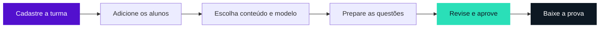

<p align="center">
  <a href="https://provaai.vercel.app/">
    
  </a>
</p>

<p align="center">
  Do perfil de cada aluno à prova impressa.<br />
  <strong>O professor escolhe o conteúdo, revisa as questões e aprova a avaliação.</strong>
</p>

<p align="center">
  <a href="https://provaai.vercel.app/"><strong>Abrir o Provaai ↗</strong></a> &nbsp;·&nbsp;
  <a href="#comece-por-aqui">Executar localmente</a> &nbsp;·&nbsp;
  <a href="docs/GUIA-TECNICO.md">Guia técnico</a> &nbsp;·&nbsp;
  <a href="docs/ESPECIFICACAO-LTP3-PROVAAI.pdf">Documentação acadêmica</a>
</p>

<p align="center">
  
  
  
  
  
</p>

---

## Uma avaliação que considera cada aluno

Uma turma pode estudar o mesmo conteúdo e precisar de provas diferentes. No **Provaai**, o professor registra o perfil pedagógico de cada aluno e escolhe a matéria, os objetivos e a divisão entre questões objetivas e discursivas. Pode escrever as questões ou pedir uma primeira versão à IA.

Para percorrer o fluxo com dados fictícios, abra o [site](https://provaai.vercel.app/) e escolha **Explorar demonstração**.

| No espaço do professor | O que você pode fazer |
| --- | --- |
| **Minhas turmas** | Criar turmas com capa, cor e ícone. Cadastrar alunos com código automático, registrar dificuldades e reativar um aluno na turma de destino. |
| **Modelos de prova** | Anexar PDF, DOC ou DOCX, escolher o padrão da conta e salvar uma escolha por turma. No PDF, conferir o recorte do cabeçalho. |
| **Provas coletivas** | Preparar avaliações por turma, acompanhar a geração em segundo plano e revisar cada rascunho. |
| **Provas individuais** | Selecionar um aluno para uma avaliação específica e manter seu vínculo com a turma de origem. |
| **Revisão e downloads** | Ajustar enunciados e respostas, aprovar a prova e baixar PDF, Word ou gabarito. Em lote, acompanhar a montagem do ZIP enquanto navega. |

### Da turma à impressão



O PDF usa a faixa da primeira página escolhida pelo professor como cabeçalho. No Word, o exportador aproveita a diagramação do modelo para montar o documento que também dará origem ao PDF. [Modelos e formatos de exportação](docs/PDF-E-ARQUIVOS.md)

## Comece por aqui

Use **PHP 8.3 ou superior**, **Composer 2** e **Node.js 24**. Habilite no PHP as extensões PDO/SQLite, mbstring, intl, fileinfo, openssl, curl, zip, XML e gd. O ambiente local usa seu próprio banco SQLite.

1. Na raiz do repositório, instale as dependências.

   ```sh
   composer install
   npm ci
   ```

2. Na primeira instalação, copie `.env.example` para `.env` e crie o arquivo vazio `database/database.sqlite`. Gere a chave da aplicação uma vez e inicie o site.

   ```sh
   php artisan key:generate
   php artisan migrate
   npm run build
   php artisan serve
   ```

3. Abra [127.0.0.1:8000](http://127.0.0.1:8000). Para processar os lotes e as tarefas agendadas, execute cada comando em um terminal próprio.

   ```sh
   php artisan queue:work --tries=1 --timeout=130
   php artisan schedule:work
   ```

Com `MAIL_MAILER=log`, o código de login local aparece em `storage/logs/laravel.log`. Para gerar provas com Gemini, configure `GEMINI_API_KEY` no `.env`. A chave opcional `GROQ_API_KEY` habilita o provedor reserva. [Configuração de e-mail e IA](docs/GUIA-TECNICO.md)

## Por dentro do projeto

| Caminho | Responsabilidade |
| --- | --- |
| `app/` e `routes/` | Sessões, acesso aos dados de cada professor, preparação das provas e processamento das filas em Laravel. |
| `components/`, `resources/` e `lib/` | Interface React, estilos, regras compartilhadas e diagramação de documentos. |
| `database/` | Migrações do banco atual e referência histórica do Supabase. |
| `scripts/` | Leitura dos modelos Word, recorte dos cabeçalhos PDF e conversão dos arquivos. |
| `tests/` e `deploy/` | Testes automatizados e configuração da aplicação na AWS. |

A aplicação e o PostgreSQL de produção rodam na AWS. A Vercel mantém o domínio público. Um push para `main` inicia a publicação na Vercel, e a VM atualiza a aplicação depois da aprovação dos testes no GitHub Actions. [Publicação e histórico de alterações](docs/MIGRACAO-LARAVEL.md#histórico-de-alterações)

<details>
<summary><strong>Desenvolvimento, testes e documentação</strong></summary>

| Comando | Uso |
| --- | --- |
| `npm run dev` | Atualizar a interface durante a edição, junto de `php artisan serve`. |
| `php artisan test` | Testar autenticação, permissões, filas, documentos e migração em banco temporário. |
| `npm test` | Testar regras da interface e arquivos de prova. |
| `npm run typecheck` | Conferir os tipos TypeScript. |
| `npm run build` | Compilar a interface para distribuição. |

- [Guia técnico](docs/GUIA-TECNICO.md)
- [Segurança e limitações conhecidas](docs/SEGURANCA.md)
- [Especificação acadêmica editável](docs/ESPECIFICACAO-LTP3-PROVAAI.md)

</details>

## Equipe

Projeto acadêmico do **IFTO**, desenvolvido na disciplina **Linguagens e Técnicas de Programação III**, com orientação do professor **Marcos Raimundo**.

**Fernando de Paula Matos** · **Vinicius Celestino** · **João Francisco** · **Gabriel Gutemberg**

<p align="center">
  <br />
  <strong>Provaai</strong>
</p>
