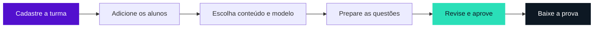

<p align="center">
  <a href="https://provaai.vercel.app/">
    
  </a>
</p>

<p align="center">
  Do perfil de cada aluno à prova impressa.<br />
  <strong>O professor escolhe o conteúdo, revisa as questões e aprova a avaliação.</strong>
</p>

<p align="center">
  <a href="https://provaai.vercel.app/"><strong>Abrir o Provaai ↗</strong></a> &nbsp;·&nbsp;
  <a href="#tecnologias-e-bibliotecas">Tecnologias</a> &nbsp;·&nbsp;
  <a href="#comece-por-aqui">Executar localmente</a> &nbsp;·&nbsp;
  <a href="docs/GUIA-TECNICO.md">Guia técnico</a> &nbsp;·&nbsp;
  <a href="docs/ESPECIFICACAO-LTP3-PROVAAI.pdf">Documentação acadêmica</a>
</p>

---

## Uma avaliação que considera cada aluno

Uma turma pode estudar o mesmo conteúdo e precisar de provas diferentes. No **Provaai**, o professor registra o perfil pedagógico de cada aluno e escolhe a matéria, os objetivos e a divisão entre questões objetivas e discursivas. Pode escrever as questões ou pedir uma primeira versão à IA.

Para percorrer o fluxo com dados fictícios, abra o [site](https://provaai.vercel.app/) e escolha **Explorar demonstração**.

| No espaço do professor | O que você pode fazer |
| --- | --- |
| **Minhas turmas** | Criar turmas com capa, cor e ícone. Cadastrar alunos com código automático, registrar dificuldades e reativar um aluno na turma de destino. |
| **Modelos de prova** | Anexar PDF, DOC ou DOCX, escolher o padrão da conta e salvar uma escolha por turma. No PDF, conferir o recorte do cabeçalho. |
| **Provas coletivas** | Preparar avaliações por turma, acompanhar a geração em segundo plano e revisar cada rascunho. |
| **Provas individuais** | Selecionar um aluno para uma avaliação específica e manter seu vínculo com a turma de origem. |
| **Revisão e downloads** | Ajustar enunciados e respostas, aprovar a prova e baixar PDF, Word ou gabarito. Em lote, acompanhar a montagem do ZIP enquanto navega. |

### Da turma à impressão



O PDF usa a faixa da primeira página escolhida pelo professor como cabeçalho. No Word, o exportador aproveita a diagramação do modelo para montar o documento que também dará origem ao PDF. [Modelos e formatos de exportação](docs/PDF-E-ARQUIVOS.md)

## Tecnologias e bibliotecas

<table align="center">
  <tr>
    <td align="center" width="120"><a href="https://devicons.io/icons/laravel/"></a><br /><sub>Laravel 13</sub></td>
    <td align="center" width="120"><a href="https://devicons.io/icons/php/"></a><br /><sub>PHP 8.3+</sub></td>
    <td align="center" width="120"><a href="https://devicons.io/icons/react/"></a><br /><sub>React 19</sub></td>
    <td align="center" width="120"><a href="https://devicons.io/icons/typescript/"></a><br /><sub>TypeScript</sub></td>
    <td align="center" width="120"><a href="https://devicons.io/icons/vite/"></a><br /><sub>Vite</sub></td>
    <td align="center" width="120"><a href="https://devicons.io/icons/nodejs/"></a><br /><sub>Node.js 24</sub></td>
  </tr>
  <tr>
    <td align="center" width="120"><a href="https://devicons.io/icons/html-5/"></a><br /><sub>HTML</sub></td>
    <td align="center" width="120"><a href="https://devicons.io/icons/css/"></a><br /><sub>CSS</sub></td>
    <td align="center" width="120"><a href="https://devicons.io/icons/javascript/"></a><br /><sub>JavaScript</sub></td>
    <td align="center" width="120"><a href="https://devicons.io/icons/zod/"></a><br /><sub>Zod</sub></td>
    <td align="center" width="120"><a href="https://devicons.io/icons/postgresql/"></a><br /><sub>PostgreSQL</sub></td>
    <td align="center" width="120"><a href="https://devicons.io/icons/sqlite/"></a><br /><sub>SQLite</sub></td>
  </tr>
  <tr>
    <td align="center" width="120"><a href="https://devicons.io/icons/docker/"></a><br /><sub>Docker</sub></td>
    <td align="center" width="120"><a href="https://devicons.io/icons/nginx/"></a><br /><sub>NGINX</sub></td>
    <td align="center" width="120"><a href="https://devicons.io/icons/aws/"></a><br /><sub>AWS</sub></td>
    <td align="center" width="120"><a href="https://devicons.io/icons/vercel/"></a><br /><sub>Vercel</sub></td>
    <td align="center" width="120"><a href="https://devicons.io/icons/google-gemini/"></a><br /><sub>Gemini</sub></td>
    <td align="center" width="120"><a href="https://devicons.io/icons/github-actions/"></a><br /><sub>GitHub Actions</sub></td>
  </tr>
  <tr>
    <td align="center" width="120"><a href="https://devicons.io/icons/git/"></a><br /><sub>Git</sub></td>
    <td align="center" width="120"><a href="https://devicons.io/icons/github/"></a><br /><sub>GitHub</sub></td>
    <td align="center" width="120"><a href="https://devicons.io/icons/npm/"></a><br /><sub>npm</sub></td>
    <td align="center" width="120"><a href="https://devicons.io/icons/composer/"></a><br /><sub>Composer</sub></td>
    <td align="center" width="120"><a href="https://devicons.io/icons/debian/"></a><br /><sub>Debian</sub></td>
    <td align="center" width="120"><a href="https://devicons.io/icons/bash/"></a><br /><sub>Bash</sub></td>
  </tr>
</table>

| Camada | Uso no Provaai |
| --- | --- |
| **Interface** | React 19 e TypeScript, com Vite e `laravel-vite-plugin`. HTML e CSS compõem as telas. Motion e `@heroicons-animated/react` animam os ícones, as transições e as barras de progresso. |
| **Aplicação** | PHP 8.3+ e Laravel 13. Blade entrega a página inicial, Eloquent acessa os dados e as filas executam a geração das provas. |
| **Dados** | PostgreSQL em produção e SQLite no ambiente local. A sessão, o cache e a fila usam o banco. Os modelos, capas e documentos ficam no armazenamento privado do servidor. |
| **Inteligência artificial** | Gemini gera e confere as questões. O código também oferece Groq como reserva quando configurado e Mistral como provedor opcional. |
| **Documentos** | LibreOffice WebAssembly, pelo pacote `@matbee/libreoffice-converter`, converte Word e PDF. `docx` e `@xmldom/xmldom` montam os documentos, e `word-extractor` lê os modelos Word. |
| **PDF e arquivos** | `pdfjs-dist` e `@napi-rs/canvas` recortam cabeçalhos. `jspdf` exporta PDFs na demonstração. `jszip` manipula modelos DOCX e reúne provas em ZIP, com `buffer` para compatibilidade no navegador. |
| **Validação e testes** | Zod valida os dados da interface. PHPUnit, Mockery e Faker cobrem o backend. O executor nativo de testes do Node verifica regras e arquivos. |
| **Publicação** | Docker e Compose na AWS, com imagem Debian e scripts Bash. NGINX e PHP-FPM atendem HTTP, Supervisor mantém os processos e SMTP entrega os códigos de login. A Vercel fornece a entrada pública e o GitHub Actions executa as verificações. |
| **Desenvolvimento** | Git e GitHub versionam o código. npm e Composer gerenciam as dependências. TypeScript verifica os tipos, Laravel Pint formata PHP, Tinker oferece o console e Pail auxilia na leitura dos logs. |

As versões instaladas ficam registradas em [package-lock.json](package-lock.json) e [composer.lock](composer.lock). Os ícones desta seção vêm do [Devicons](https://devicons.io/).

## Comece por aqui

Use **PHP 8.3 ou superior**, **Composer 2** e **Node.js 24**. Habilite no PHP as extensões PDO/SQLite, mbstring, intl, fileinfo, openssl, curl, zip, XML e gd. O ambiente local usa seu próprio banco SQLite.

1. Na raiz do repositório, instale as dependências.

   ```sh
   composer install
   npm ci
   ```

2. Na primeira instalação, copie `.env.example` para `.env` e crie o arquivo vazio `database/database.sqlite`. Gere a chave da aplicação uma vez e inicie o site.

   ```sh
   php artisan key:generate
   php artisan migrate
   npm run build
   php artisan serve
   ```

3. Abra [127.0.0.1:8000](http://127.0.0.1:8000). Para processar os lotes e as tarefas agendadas, execute cada comando em um terminal próprio.

   ```sh
   php artisan queue:work --tries=1 --timeout=130
   php artisan schedule:work
   ```

Com `MAIL_MAILER=log`, o código de login local aparece em `storage/logs/laravel.log`. Para gerar provas com Gemini, configure `GEMINI_API_KEY` no `.env`. A chave opcional `GROQ_API_KEY` habilita o provedor reserva. [Configuração de e-mail e IA](docs/GUIA-TECNICO.md)

## Por dentro do projeto

| Caminho | Responsabilidade |
| --- | --- |
| `app/` e `routes/` | Sessões, acesso aos dados de cada professor, preparação das provas e processamento das filas em Laravel. |
| `components/`, `resources/` e `lib/` | Interface React, estilos, regras compartilhadas e diagramação de documentos. |
| `database/` | Migrações do banco atual e referência histórica do Supabase. |
| `scripts/` | Leitura dos modelos Word, recorte dos cabeçalhos PDF e conversão dos arquivos. |
| `tests/` e `deploy/` | Testes automatizados e configuração da aplicação na AWS. |

A aplicação e o PostgreSQL de produção rodam na AWS. A Vercel mantém o domínio público. Um push para `main` inicia a publicação na Vercel, e a VM atualiza a aplicação depois da aprovação dos testes no GitHub Actions. [Publicação e histórico de alterações](docs/MIGRACAO-LARAVEL.md#histórico-de-alterações)

<details>
<summary><strong>Desenvolvimento, testes e documentação</strong></summary>

| Comando | Uso |
| --- | --- |
| `npm run dev` | Atualizar a interface durante a edição, junto de `php artisan serve`. |
| `php artisan test` | Testar autenticação, permissões, filas, documentos e migração em banco temporário. |
| `npm test` | Testar regras da interface e arquivos de prova. |
| `npm run typecheck` | Conferir os tipos TypeScript. |
| `npm run build` | Compilar a interface para distribuição. |

- [Guia técnico](docs/GUIA-TECNICO.md)
- [Segurança e limitações conhecidas](docs/SEGURANCA.md)
- [Especificação acadêmica editável](docs/ESPECIFICACAO-LTP3-PROVAAI.md)

</details>

## Equipe

Projeto acadêmico do **IFTO**, desenvolvido na disciplina **Linguagens e Técnicas de Programação III**, com orientação do professor **Marcos Raimundo**.

**Fernando de Paula Matos** · **Vinicius Celestino** · **João Francisco** · **Gabriel Gutemberg**

<p align="center">
  <br />
  <strong>Provaai</strong>
</p>
